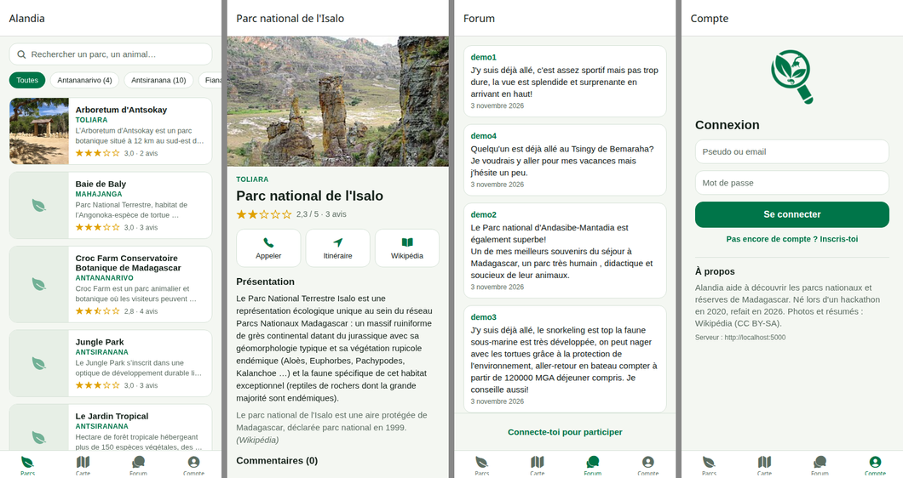

# Alandia

Une app mobile pour découvrir les **parcs nationaux et réserves de Madagascar** : 35 sites avec
leur description, leur position, une photo et un résumé Wikipédia, des notes et des commentaires
de visiteurs, une carte et un forum.



> Né en novembre 2020 lors d'un hackathon (Expo SDK 39 + Flask + MySQL, une seule liste
> fonctionnelle). Refait en 2026 : stack à jour, toutes les fonctions branchées, tests.

## Fonctionnalités

- **Parcs** : recherche (nom, faune, flore…), filtre par province, note moyenne.
- **Fiche d'un parc** : photo et résumé Wikipédia, appel du parc, itinéraire dans l'app de
  cartes du téléphone, note de 1 à 5 étoiles, commentaires.
- **Carte** : les 35 parcs sur une carte de Madagascar ; toucher une bulle ouvre la fiche.
- **Forum** : questions et bons plans entre voyageurs.
- **Compte** : inscription et connexion (mots de passe hachés, jeton signé gardé dans le
  stockage sécurisé du téléphone).

## Structure

```
backend/   API REST Flask + SQLite (Python 3.11+, uv)
mobile/    App Expo (SDK 58, Expo Router, TypeScript) — Android, iOS et web
docs/      Captures d'écran
```

## Lancer le projet

### 1. L'API

```bash
cd backend
cp .env.example .env
python -c "import secrets; print(secrets.token_hex(32))"   # à coller dans ALANDIA_SECRET_KEY
uv sync
uv run flask --app alandia run --host 0.0.0.0 --port 5000
```

La base SQLite est créée avec les 35 parcs au premier démarrage (`backend/instance/`).
Pour la recréer : `uv run flask --app alandia init-db --force`.

### 2. L'app

```bash
cd mobile
npm install
npx expo start
```

Scanne le QR code avec **Expo Go** (téléphone sur le même Wi-Fi que l'ordinateur) : l'app trouve
l'API toute seule. Pour une autre adresse, copie `.env.example` en `.env` et renseigne
`EXPO_PUBLIC_API_URL`. Touche `w` pour la version web (sans carte interactive).

## API

| Méthode | Route | Rôle |
|---|---|---|
| GET | `/api/parks?q=&province=` | Liste des parcs (recherche, filtre) |
| GET | `/api/parks/<id>` | Fiche d'un parc et ses commentaires |
| GET | `/api/provinces` | Les 6 provinces et leur nombre de parcs |
| GET | `/api/forum` | Messages du forum, du plus récent au plus ancien |
| POST | `/api/auth/register` · `/api/auth/login` | Inscription, connexion → `{ token, user }` |
| GET | `/api/auth/me` | Utilisateur connecté 🔒 |
| PUT | `/api/parks/<id>/rating` | Noter un parc (1 à 5) 🔒 |
| GET | `/api/parks/<id>/my-rating` | Ma note 🔒 |
| POST | `/api/parks/<id>/comments` | Commenter un parc 🔒 |
| POST | `/api/forum` | Écrire sur le forum 🔒 |

🔒 : en-tête `Authorization: Bearer <token>`.

## Vérifications

```bash
cd backend && uv run pytest && uv run ruff check .
cd mobile && npm run typecheck && npm run lint
```

## Données

Les 35 parcs, les provinces, les notes et les premiers messages du forum viennent de la base du
hackathon de 2020 (comptes de l'époque remplacés par `demo1` à `demo4`, qui ne peuvent pas se
connecter). Photos et résumés : [Wikipédia](https://fr.wikipedia.org), sous licence CC BY-SA.
